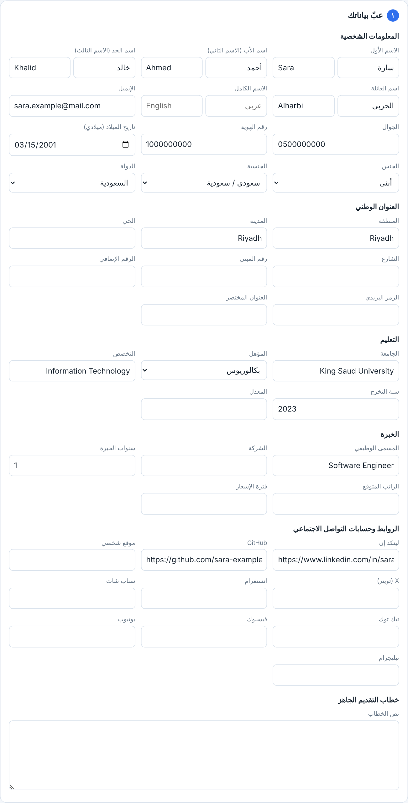
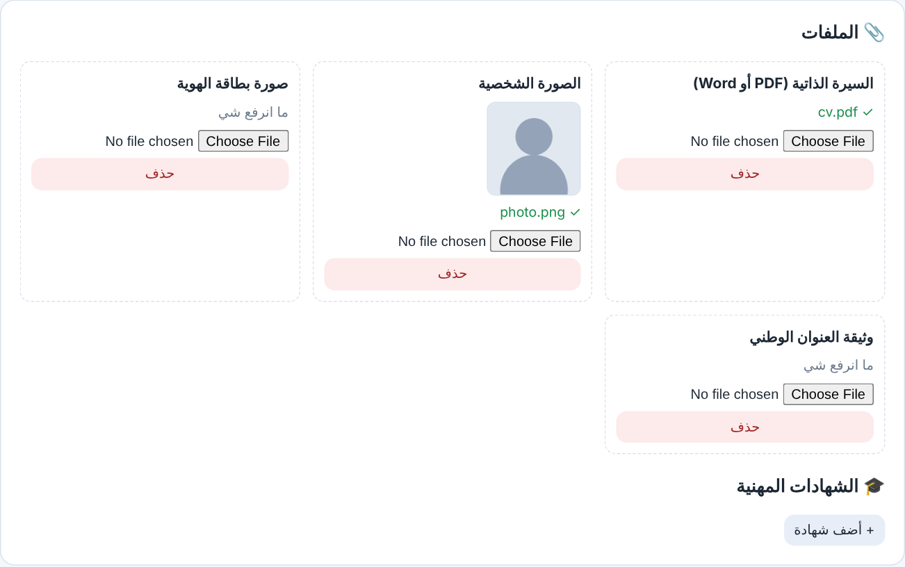
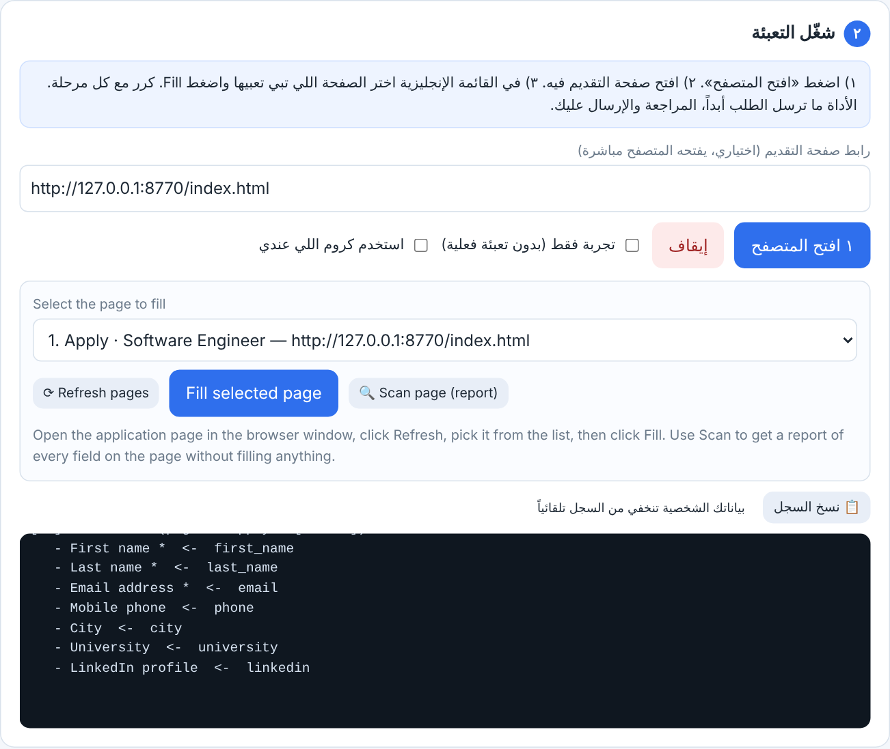
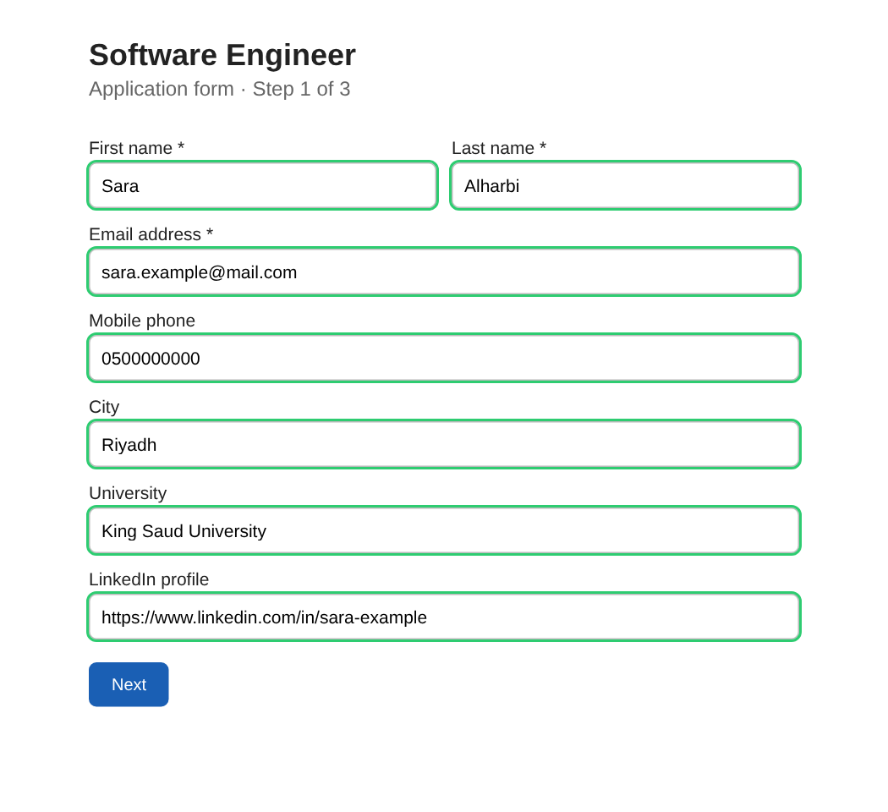

# job-autofill 🤖

أداة مجانية تعبّي لك صفحات التقديم على الوظائف من بياناتك المحفوظة. **ما ترسل الطلب أبداً**، المراجعة والإرسال عليك.

من تطوير **Reyof** · [@4lavc](https://x.com/4lavc)

> 😅 لا تخاف، ما بهكّرك! سويت الأداة لأني مليت من التقديم مثلك. والكود مفتوح قدامك، اقرأه بنفسك قبل ما تشغّله.

---

## ١) شغّل الأداة
- **ويندوز:** دبل كليك على `start.bat` (يحتاج Python، وفعّل **Add python.exe to PATH** وقت تثبيته)
- **ماك / لينكس:** `./start.sh`

أول مرة ياخذ كم دقيقة يجهز كل شي، وبعدها تفتح الواجهة في المتصفح. وبيسألك إذا تبي **اختصار على سطح المكتب بأيقونة الأداة** (ملفات `.bat` ما تقبل أيقونة، فالاختصار هو الحل).

## ٢) عبّ بياناتك مرة وحدة
كل شي اختياري، والحقل الفاضي تتجاهله الأداة. بعدها اضغط **حفظ البيانات**.



## ٣) ارفع ملفاتك
السيرة الذاتية والصورة والهوية والعنوان الوطني والشهادات. تنحفظ تلقائياً.



## ٤) افتح صفحة التقديم وعبّها
1. الصق رابط صفحة التقديم واضغط **افتح المتصفح**.
2. في النافذة اللي انفتحت، افتح صفحة التقديم (وسجّل دخولك لو لزم).
3. ارجع للواجهة، اضغط **Refresh pages**، اختر الصفحة، واضغط **Fill selected page**.



الحقول اللي عبّتها الأداة تظهر بإطار أخضر. راجعها وكمّل الباقي بنفسك، وكرر الخطوة على كل مرحلة.



> الصور فيها بيانات وهمية.

---

## 🔒 خصوصيتك
- كل شي يشتغل **على جهازك**، وبياناتك ما تنرسل لأي جهة.
- بياناتك وملفاتك **مشفّرة على القرص** (`profile.enc` وملفات `.enc`). مفتاح التشفير في خزنة نظامك (Credential Manager / Keychain / Secret Service)، والأداة تفكها في الذاكرة بس وقت الاستخدام. يعني لو فتحت الملف بنفسك ما تفهم منه شي. ولو ضاع المفتاح (مثل إعادة تثبيت النظام) ما تنفتح البيانات وتبدأ من جديد.
- التشفير يحميك من تسريب الملفات (سحابة، نسخ، مستخدم ثاني)، لكنه ما يوقف برنامج خبيث يشتغل بحسابك.
- بياناتك تنحفظ في مجلد خاص بحسابك **خارج مجلد الأداة** (ويندوز `%APPDATA%\job-autofill`)، فلو أرسلت الأداة لأحد ما ينرسل معها شي منها.
- زر **«حذف كل بياناتي»** أسفل الصفحة يمسح كل شي.
- زر «نسخ السجل» يخفي اسمك وإيميلك وجوالك وهويتك، ومع ذلك راجع النص قبل ما تلصقه في أي مكان.
- الأداة تعبّي أي صفحة تفتحها، فافتح صفحات التقديم الرسمية فقط.

<details>
<summary>تفاصيل تقنية (اختياري)</summary>


### التشغيل بالطرفية
```
pip install -r requirements.txt
python -m playwright install chromium
python job_autofill.py          # يفتح الواجهة
# أو بدون واجهة: python job_autofill.py --worker --dry-run
```

| الخيار (`--worker`) | وظيفته |
|---|---|
| `--dry-run` | يعرض وش بيعبي بدون ما يعبي فعلياً |
| `--overwrite` | يكتب فوق الحقول المعبّاة مسبقاً |
| `--chrome` | يستخدم كروم المثبت عندك |
| `--profile ملف.json` | يستخدم ملف بيانات ثاني |

### الأمان
- الواجهة ما تقبل اتصال إلا من جهازك.
- الملفات اللي ترفعها الأداة لازم تكون داخل مجلد `my_files`.
- تتجاهل الحقول المخفية أو الخارجة عن الشاشة والإطارات الصغيرة المخفية.
- لو انتقلت البيانات لجهاز أو حساب ثاني، الأداة تحذفها عند التشغيل.
- مجلد `.browser_profile` يحفظ تسجيلات دخولك، لا تشاركه.

### لو تبي تعدّل الأداة على حالتك
افتح `KEYWORDS` في `job_autofill.py` (ابحث عنها بالاسم): كل حقل له كلمات يدور عليها في اسم الحقل. أضف كلمات جديدة (عربي أو إنجليزي) لو موقع ما انعرف فيه حقل.

</details>
